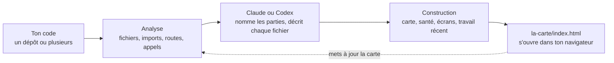

<div align="center">

# La carte

**Vois comment ton appli tient vraiment ensemble.**

Claude ou Codex lit ton code et en dessine une carte interactive. Chaque partie, chaque fichier et chaque appel au serveur reçoit un nom en langage simple, et chaque lien entre eux est montré.

Licence MIT · Node 18 ou plus · aucune dépendance

[Installation](#installation) · [Démarrage rapide](#démarrage-rapide) · [Comparaison](#comparaison-avec-archify-et-understand-anything) · [Fonctions](#fonctions) · [Voir en images](#voir-en-images) · [Comment ça marche](#comment-ça-marche) · [Documentation](docs/README.md) · [FAQ](#faq)

</div>

> **La carte est une traduction française non officielle de Floorplan.** Cette copie est faite par une personne qui n'a aucun lien avec l'auteur du plugin. Tout le code a été réécrit en français à partir de la version 0.6.3 de l'auteur. Elle n'est reliée à aucune de ses mises à jour : une correction publiée par l'auteur n'arrive pas toute seule ici, il faut la reprendre à la main (voir [Reprendre une correction de l'auteur](docs/bien-demarrer.md#reprendre-une-correction-de-lauteur)).
>
> Floorplan a été créé par **[Hayden Smith](https://github.com/haydenschmitty)**. Dépôt d'origine : <https://github.com/haydenschmitty/floorplan>. Le travail est à lui, cette copie ne fait que le traduire et en retirer quelques fonctions (voir le [journal des changements](CHANGELOG.md#version-française)). Licence MIT conservée, voir [LICENSE](LICENSE).
>
> **Les images** de ce dépôt (`docs/images/`) sont des captures d'écran de la version d'origine : leur interface est en anglais. Les noms des boutons dans le texte sont ceux de cette version française.

## Pourquoi la carte ?

Tu as construit une appli, probablement avec beaucoup d'aide de l'IA, et elle marche. Mais si on te demande « que se passe-t-il quand quelqu'un passe commande ? » ou « qu'est-ce qui casse si je change ça ? », la réponse honnête est *aucune idée*.

La carte te donne le schéma que personne n'a dessiné. Demande une carte à Claude Code ou à Codex : quelques minutes plus tard tu as une carte que tu peux explorer, interroger, et garder à jour au fil de ton travail.

- **Pour toi qui construis :** comprendre l'appli que tu as faite, avec tes mots, sans lire le code.
- **Pour une équipe :** accueillir quelqu'un en quelques minutes, de la vue d'ensemble jusqu'au fichier précis.
- **Pour travailler avec une IA :** après chaque modification de Claude ou de Codex, voir exactement quelles parties il a touchées et pourquoi.


## Fonctions

<table>
<tr>
<td width="50%" valign="top">

**🗺️ Une carte à chaque niveau de zoom**<br>
Pars de l'appli entière, puis double-clique pour entrer dans une partie, un groupe de fichiers, un fichier, et ses adresses du serveur. Chaque vue montre ce qui l'utilise et ce qu'elle utilise.

</td>
<td width="50%" valign="top">

**💬 Du langage simple partout**<br>
« Encaisse les paiements par carte à la commande », pas « enveloppe de l'API Stripe ». Les termes techniques s'expliquent au survol, et un interrupteur affiche la vue pour développeurs.

</td>
</tr>
<tr>
<td valign="top">

**🔌 De vrais liens, même entre dépôts**<br>
Elle suit les imports, et relie chaque appel au serveur de ton interface à l'adresse du serveur qui y répond, même quand ils sont dans des dépôts séparés.

</td>
<td valign="top">

**🖥️ Partir d'un écran**<br>
Choisis une page que tu connais et vois tout ce qu'il y a derrière : ses parties, les appels qu'elle fait, le code du serveur, les données et les services extérieurs.

</td>
</tr>
<tr>
<td valign="top">

**🧭 Poser une question à la carte**<br>
« Comment un remboursement arrive-t-il sur la carte bancaire du client ? » donne une réponse et une mini-carte des seuls éléments concernés, avec une explication pas à pas.

</td>
<td valign="top">

**🩺 Contrôle de santé**<br>
Repère les erreurs classiques des applis faites avec l'IA : clés dans le code ou envoyées au navigateur, tables Supabase lisibles par tout le monde, règles Firebase ouvertes, webhooks Stripe que n'importe qui pourrait falsifier, adresses du serveur sans connexion. Chaque problème vient avec une demande de correction prête à coller. Un contrôle, pas un audit, et il se trompe parfois.

</td>
</tr>
<tr>
<td valign="top">

**🟢 Travail récent**<br>
Les blocs que ton IA vient de changer s'allument en vert, chacun avec une note qui dit en quoi la modification répond à ce que tu avais demandé.

</td>
<td valign="top">

**⚡ À jour, et à toi**<br>
Une mise à jour ne relit que ce qui a changé, et une carte déjà ouverte se recharge toute seule. Tout tourne sur ta machine, et rien n'est enregistré dans Git.

</td>
</tr>
</table>

Il y a aussi des **parcours** guidés que tu peux demander avec tes mots, une **visite guidée** d'une minute (**Commencer ici**), **Exporter** pour envoyer une copie à n'importe qui en un seul fichier HTML, une disposition pour **téléphones et tablettes** avec glisser et pincer, la recherche, des raccourcis clavier et des actions au clic droit sur chaque bloc.

### Les plans, pour une appli pas encore construite

La carte est fait pour cartographier du code que tu as déjà. Il peut aussi partir d'un cahier des charges, d'une spécification ou d'une description de ce que tu veux construire, et dessiner un **plan** : la même carte, qui montre chaque partie, fichier, adresse du serveur et écran dont tu aurais besoin et comment ils s'assembleraient. Les blocs sont en pointillés pour montrer que c'est un plan. À la place du contrôle de santé, tu as une revue de ce que le plan laisse encore ouvert, chaque partie a sa demande toute prête pour la construire, et tu peux remodeler le plan depuis la carte (« prévois aussi les remboursements »). Quand le code existe, le plan devient une carte de la vraie appli. Voir [Planifier une appli pas encore construite](docs/bien-demarrer.md#planifier-une-appli-pas-encore-construite).

## Voir en images

Ces captures viennent de la version d'origine : leur interface est en anglais. Elles montrent la même chose que cette version française.

<table>
<tr>
<td width="50%" valign="top">

<p><b>Poser une question à la carte.</b> Une vraie réponse, donnée par le Claude Code en ligne de commande en 31 secondes. Elle a suivi le cadeau du formulaire jusqu'à la boîte mail à travers deux dépôts, et a repéré deux bogues en route.</p>
</td>
<td width="50%" valign="top">

<p><b>Partir d'un écran.</b> Choisis une page et vois tout ce qu'il y a derrière, du bouton jusqu'à la base de données et aux services extérieurs.</p>
</td>
</tr>
<tr>
<td valign="top">

<p><b>Travail récent.</b> Ce que tu avais demandé, ce qui a changé et pourquoi chaque changement était nécessaire, sur un seul tableau.</p>
</td>
<td valign="top">

<p><b>Contrôle de santé.</b> Un mot de passe oublié dans le code et une adresse du serveur que tout le monde peut appeler, chacun avec une demande de correction en un clic.</p>
</td>
</tr>
<tr>
<td valign="top">

<p><b>Zoomer.</b> Dans n'importe quelle partie : ce qu'elle contient, ce qui l'utilise et ce dont elle dépend. Les étiquettes vertes marquent ce qui vient de changer.</p>
</td>
<td valign="top">

<p><b>Parcours guidés.</b> Regarde un appel traverser l'appli étape par étape, ou demande qu'on en suive un nouveau.</p>
</td>
</tr>
</table>

## Installation

Il te faut [Node.js 18 ou plus](https://nodejs.org) et Claude Code ou Codex. La carte marche avec l'abonnement que tu as déjà, sans clé d'API.

Cette copie ne passe par aucune boutique de plugins : tu l'installes depuis son dossier sur ta machine ou depuis son dépôt Git. Le plugin et la source s'appellent tous deux `la-carte`.

### Claude Code

Dans l'onglet Code de l'application de bureau ou en ligne de commande, depuis le dossier de cette copie :

```bash
claude plugin marketplace add /chemin/vers/la-carte
claude plugin install la-carte@la-carte
```

(ou, depuis le dépôt Git de cette copie : `claude plugin marketplace add <compte>/la-carte`, si ton Git a accès au dépôt.)

Ouvre une nouvelle session et c'est prêt. Installer la ligne de commande de Claude Code est conseillé même si tu utilises l'application de bureau, parce que c'est elle qui permet à la bulle de questions de lire ton vrai code. La suite est dans [Pour commencer](docs/bien-demarrer.md).

### Codex

Connecté avec ChatGPT. Pas besoin de terminal :

1. Dans l'application Codex, ouvre **Plugins** et choisis **Add a marketplace**.
2. Pour **Source**, entre le chemin du dossier de cette copie (ou son dépôt Git) et clique sur **Add marketplace**.
3. Trouve **La carte** et clique sur **+** pour l'installer.

Ou depuis un terminal :

```bash
codex plugin marketplace add /chemin/vers/la-carte
codex plugin add la-carte@la-carte
```

Ouvre une nouvelle discussion et demande une carte, ou tape `$la-carte`. La bulle de questions de la carte utilise ta propre connexion à Codex, sans clé d'API. La suite est dans [la carte dans Codex](docs/codex.md).

## Démarrage rapide

1. Ouvre ton projet dans Claude Code ou Codex. Si l'interface et le serveur sont dans des dépôts séparés, ouvre le dossier qui contient les deux.
2. Demande :
   > Fais-moi une carte de cette appli.

   (Dans Claude Code tu peux aussi taper `/la-carte:la-carte`, et dans Codex `$la-carte`.)
3. Explore. La carte s'ouvre toute seule, en commençant par une courte visite guidée.

Quand tu as avancé, demande :

> Mets à jour la carte.

Seul ce qui a changé est relu, et ce sur quoi tu viens de travailler s'allume dans **Travail récent**.

**Pas encore de code ?** La carte peut planifier une appli à partir d'un cahier des charges ou d'une spécification. Donne le document et demande :

> Voici mon cahier des charges. Fais-moi une carte de ce qu'il faudrait construire.

Tu obtiens un [plan](#les-plans-pour-une-appli-pas-encore-construite) du système prévu, clairement marqué comme un plan.

### À essayer

| Demande à Claude Code ou à Codex | Demande à la carte |
|---|---|
| « Fais-moi une carte de cette appli » | « Que se passe-t-il quand quelqu'un passe commande ? » |
| « Mets à jour la carte » | « Où parle-t-on à Stripe ? » |
| « Corrige les problèmes importants du contrôle de santé de la carte » | « Si je change la table des utilisateurs, qu'est-ce qui casse ? » |
| « Ajoute un parcours qui montre comment un nouvel utilisateur s'inscrit » | « Quels fichiers gèrent la connexion ? » |
| « Réécris la carte pour des développeurs » | « Qu'avons-nous changé pour les remboursements ? » |
| « Exporte la carte que je l'envoie à l'équipe » | |

## Comment ça marche



Des scripts font le travail mécanique : trouver les dépôts, lire le code dans une douzaine de langages, relier les appels aux adresses du serveur, disposer la carte. C'est du Node simple, sans dépendance. Claude ou Codex fait la partie que seul un lecteur peut faire : décider ce que les parties de ton appli *sont*, et le dire simplement. Les détails sont dans [Comment ça marche](docs/comment-ca-marche.md).

**Langages :** TypeScript, JavaScript, Python, Go, Rust, Java, Kotlin, Scala, plus les fichiers Vue, Svelte et Astro, avec une prise en charge plus légère des autres.<br>
**Adresses du serveur :** Express, Fastify, Koa, Hono, Next.js, Firebase Cloud Functions, Flask, FastAPI, Django, net/http de Go, Gin, Echo et chi, Actix, Axum, Spring, et les tables de routes indexées par méthode et chemin (`"GET /api/orders": listOrders`) en JavaScript et en Python.<br>
**Écrans :** Next.js, React Router, Vue, SvelteKit, Remix, Nuxt, Astro, Expo, Angular, TanStack.

## Ce que ça ajoute à ton projet

Un dossier `la-carte/` qui contient la carte, et rien d'autre. **Il n'est pas enregistré dans Git :** le dossier s'ignore lui-même. Ton `.gitignore`, tes fichiers de notes pour Claude (`CLAUDE.md`, `CLAUDE.local.md`) et tes autres fichiers ne sont jamais touchés. Voir [Ce qu'il y a dans ton projet](docs/fichiers-du-projet.md).

## Confidentialité

- L'analyse, la carte et son petit serveur local tournent sur ton ordinateur. Le serveur n'accepte que les connexions venant de ta propre machine (`127.0.0.1`).
- La carte elle-même n'envoie rien sur Internet : pas de statistiques, pas de suivi, pas de liste d'attente. La carte marche hors connexion, son moteur de mise en page et ses polices sont intégrés.
- Pas de dépendances ni de scripts d'installation.
- **Mais Claude lit ton code pour le décrire, et ce code part chez Anthropic** (ou chez OpenAI avec Codex), sur ton compte, comme n'importe quelle tâche que tu lui donnes.
- Les questions posées sur la carte passent par la ligne de commande de Claude Code ou par Codex, qui peuvent lire ton code mais pas le modifier. Avec Claude Code, la bulle de questions ne peut pas ouvrir les fichiers de secrets (`.env`, `*.pem`, `*.key`…), mais elle lit le reste de tes fichiers.
- Le contrôle de santé ne garde aucune partie d'une clé (seulement sa longueur). Il donne des fausses alertes et n'est pas un audit de sécurité.

Plus de détails dans [Confidentialité et sécurité](docs/confidentialite-et-securite.md). Pour savoir si ce plugin est sûr à installer, [Est-ce sûr à installer ?](docs/est-ce-sur.md) liste tout ce que la carte fait sur ton ordinateur et ses limites.

## Documentation

| | |
|---|---|
| [Pour commencer](docs/bien-demarrer.md) | Installation, première carte, mise à jour, planifier à partir d'un cahier des charges, reprendre une correction de l'auteur, retirer |
| [la carte dans Codex](docs/codex.md) | Installer et utiliser la carte dans Codex |
| [Utiliser la carte](docs/utiliser-la-carte.md) | Chaque bouton, vue, raccourci et menu |
| [Comment ça marche](docs/comment-ca-marche.md) | Le déroulé, la mise en relation des appels, les mises à jour |
| [Ce qu'il y a dans ton projet](docs/fichiers-du-projet.md) | Chaque fichier créé par la carte, et comment le modifier |
| [Confidentialité et sécurité](docs/confidentialite-et-securite.md) | Ce qui tourne où, et ce qui quitte ta machine |
| [Est-ce sûr à installer ?](docs/est-ce-sur.md) | Ce que fait le plugin, les programmes qu'il lance, ses limites honnêtes |
| [Dépannage](docs/depannage.md) | Les problèmes courants et leurs solutions |
| [Développer la carte](docs/developpement.md) | Organisation du dépôt, tests, versions marquées |

## FAQ

<details>
<summary><b>Est-ce sûr à installer ?</b></summary>

Le plugin n'a ni crochets (hooks), ni serveurs MCP, ni dépendances, ne télécharge rien et n'exécute jamais de code venu d'Internet. Il ne se connecte à aucun service extérieur. Un test vérifie tout cela, et tu peux le relancer toi-même. Mais ça ne veut pas dire « sans risque » : Claude lit ton code et l'envoie à Anthropic, et le contrôle de santé n'est pas un audit. Tout est dans [Est-ce sûr à installer ?](docs/est-ce-sur.md).
</details>

<details>
<summary><b>Mon code quitte-t-il mon ordinateur ?</b></summary>

Oui, de la façon dont Claude Code et Codex fonctionnent toujours : l'IA lit les fichiers dont elle a besoin pour décrire ton appli, et ils partent chez Anthropic (ou OpenAI) sur ton compte. La carte elle-même est un fichier local et son serveur n'écoute que sur ta machine. Si tu choisis d'ouvrir la carte dans l'application Claude, Claude envoie la carte (noms, descriptions et structure, pas ton code source) vers ton compte claude.ai privé, et il te le demande avant. La carte elle-même n'envoie rien.
</details>

<details>
<summary><b>Combien de temps ça prend, et combien ça coûte ?</b></summary>

Une première carte prend quelques minutes pour une petite appli et plus pour une grosse, parce que chaque fichier et chaque adresse du serveur est décrit. Ça consomme ton abonnement Claude ou ChatGPT comme n'importe quelle autre tâche. Les gros projets sont répartis entre plusieurs aides en parallèle. Les mises à jour ne relisent que ce qui a changé : elles sont rapides et légères.
</details>

<details>
<summary><b>Faut-il la ligne de commande pour la bulle de questions ?</b></summary>

Non, la carte marche sans. La bulle de questions répond grâce à la ligne de commande de Claude Code ou à Codex, qui peuvent lire ton vrai code. L'application de bureau de Codex contient déjà ce qu'il faut. Avec Claude, sans la ligne de commande, tu peux poser tes questions depuis l'application Claude, à partir de la carte seule.
</details>

<details>
<summary><b>Va-t-elle modifier ou enregistrer mes fichiers ?</b></summary>

Elle n'écrit que dans son propre dossier `la-carte/`, qui n'est pas enregistré dans Git. Elle ne modifie jamais ton code, ton `.gitignore` ni tes fichiers `CLAUDE.md` ou `CLAUDE.local.md`. (Les demandes « Corriger avec Claude » que tu copies, elles, servent à demander à Claude de modifier ton code, et c'est toi qui les colles.)
</details>

<details>
<summary><b>Les noms choisis ne sont pas ceux qu'on utilise chez nous. Puis-je les changer ?</b></summary>

Oui. Demande simplement (« renomme "Serveur principal" en "API boutique" dans la carte »), ou modifie toi-même `la-carte/architecture.json` et `la-carte/descriptions/`. Tes modifications sont gardées à chaque mise à jour.
</details>

<details>
<summary><b>Est-ce que ça marche avec Codex comme avec Claude Code ?</b></summary>

Oui. C'est le même plugin, la même carte et le même contrôle de santé. Chaque application le fait tourner sur ton propre abonnement : Claude Code sur ton compte Claude, Codex sur ta connexion ChatGPT. Une carte faite avec l'un s'ouvre sans problème avec l'autre. Une limite, honnête : le blocage des fichiers de secrets de la bulle de questions n'existe qu'avec Claude Code. Voir [la carte dans Codex](docs/codex.md).
</details>

<details>
<summary><b>Puis-je l'utiliser avant d'avoir écrit du code ?</b></summary>

Oui, même si cartographier du code existant est son usage principal. Donne un cahier des charges, une spécification ou une description de ton appli et demande une carte : tu obtiens un plan, une carte de ce qu'il faudrait construire, marquée comme un plan, avec une revue des décisions encore ouvertes. Tu peux le modifier depuis la carte, puis passer à une carte du vrai code une fois qu'il est construit. Voir [Planifier une appli pas encore construite](docs/bien-demarrer.md#planifier-une-appli-pas-encore-construite).
</details>

<details>
<summary><b>Est-ce que ça marche avec les monorepos et les projets en plusieurs dépôts ?</b></summary>

Oui. Pointe-le sur un monorepo, sur un sous-dossier, ou sur un simple dossier qui contient plusieurs dépôts côte à côte. Il trouve chaque dépôt et les relie.
</details>

<details>
<summary><b>Pourquoi une version française ?</b></summary>

Cette copie existe pour que le plugin, son code, ses messages et ses réponses soient entièrement en français, par et pour un francophone. Elle n'est pas reliée à l'original : voir [Pour commencer](docs/bien-demarrer.md#reprendre-une-correction-de-lauteur) pour reprendre une correction de l'auteur.
</details>

## Signaler un problème

Pour un défaut de sécurité, lis [SECURITY.md](SECURITY.md). Pour le reste, écris à la personne qui tient ce dépôt. L'auteur d'origine n'a rien à voir avec cette copie : ne lui envoie pas de demande à son sujet.

## Licence

[MIT](LICENSE) © 2026 [Hayden Smith](https://github.com/haydenschmitty)

Cette traduction est elle aussi sous licence MIT. La mention de copyright de l'auteur d'origine reste dans le fichier [LICENSE](LICENSE).
