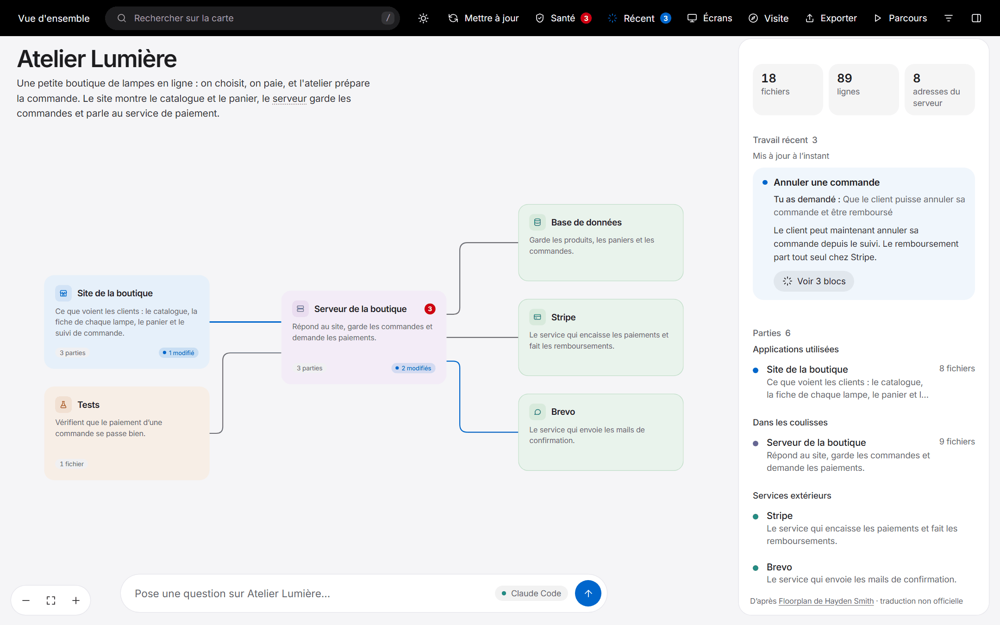
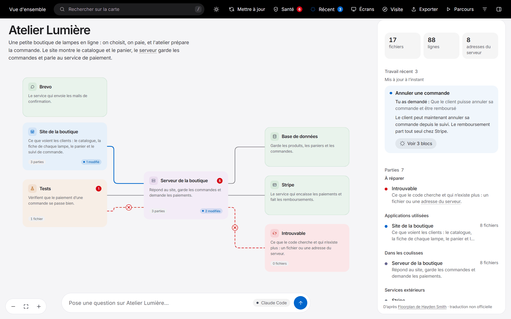

<div align="center">

# La carte

**Vois comment ton appli tient vraiment ensemble.**

Claude lit ton code et en dessine une carte interactive. Chaque partie, chaque fichier et chaque appel au serveur reçoit un nom en langage simple, et chaque lien entre eux est montré.

Licence MIT · Node 18 ou plus · aucune dépendance · construit avec Claude Code

[Installation](#installation) · [Démarrage rapide](#démarrage-rapide) · [Ce qui consomme des jetons](#ce-qui-consomme-des-jetons) · [Documentation](#documentation)

</div>

> **La carte est une traduction française non officielle de Floorplan.** Cette copie est faite par une personne qui n'a aucun lien avec l'auteur du plugin. Tout le code a été réécrit en français à partir de la version 0.6.3 de l'auteur. Elle n'est reliée à aucune de ses mises à jour : une correction publiée par l'auteur n'arrive pas toute seule ici, il faut la reprendre à la main (voir [Reprendre une correction de l'auteur](docs/bien-demarrer.md#reprendre-une-correction-de-lauteur)).
>
> Floorplan a été créé par **[Hayden Smith](https://github.com/haydenschmitty)**. Dépôt d'origine : <https://github.com/haydenschmitty/floorplan>. Le travail est à lui, cette copie ne fait que le traduire et en retirer quelques fonctions (voir le [journal des changements](CHANGELOG.md#version-française)). Licence MIT conservée, voir [LICENSE](LICENSE).

## Pourquoi la carte ?

Tu as construit une appli, probablement avec beaucoup d'aide de l'IA, et elle marche. Mais si on te demande « que se passe-t-il quand quelqu'un passe commande ? » ou « qu'est-ce qui casse si je change ça ? », la réponse honnête est *aucune idée*.

La carte te donne le schéma que personne n'a dessiné. Demande une carte à Claude Code : quelques minutes plus tard tu as une carte que tu peux explorer, interroger, et garder à jour au fil de ton travail.

- **Pour toi qui construis :** comprendre l'appli que tu as faite, avec tes mots, sans lire le code.
- **Pour une équipe :** accueillir quelqu'un en quelques minutes, de la vue d'ensemble jusqu'au fichier précis.
- **Pour travailler avec une IA :** après chaque modification de Claude, voir exactement quelles parties il a touchées et pourquoi.





D'autres captures dans [Tout ce que fait la carte](docs/fonctions.md#voir-en-images).

## Installation

Il te faut [Node.js 18 ou plus](https://nodejs.org) et Claude Code. La carte marche avec l'abonnement que tu as déjà, sans clé d'API.

Cette copie ne passe par aucune boutique de plugins : tu l'installes depuis son dossier sur ta machine ou depuis son dépôt Git. Le plugin et la source s'appellent tous deux `la-carte`.

Dans l'onglet Code de l'application de bureau ou en ligne de commande, depuis le dossier de cette copie :

```bash
claude plugin marketplace add /chemin/vers/la-carte
claude plugin install la-carte@la-carte
```

(ou, depuis le dépôt Git de cette copie : `claude plugin marketplace add <compte>/la-carte`, si ton Git a accès au dépôt.)

Ouvre une nouvelle session et c'est prêt. Installer la ligne de commande de Claude Code est conseillé même si tu utilises l'application de bureau, parce que c'est elle qui permet à la bulle de questions de lire ton vrai code. La suite est dans [Pour commencer](docs/bien-demarrer.md).

## Démarrage rapide

1. Ouvre ton projet dans Claude Code. Si l'interface et le serveur sont dans des dépôts séparés, ouvre le dossier qui contient les deux.
2. Demande :
   > Fais-moi une carte de cette appli.

   (Tu peux aussi taper `/la-carte:la-carte`.)
3. Explore. La carte s'ouvre toute seule, en commençant par une courte visite guidée.

Quand tu as avancé, demande :

> Mets à jour la carte.

Seul ce qui a changé est relu, et ce sur quoi tu viens de travailler s'allume dans **Travail récent**.

**Pas encore de code ?** La carte peut planifier une appli à partir d'un cahier des charges ou d'une spécification. Donne le document et demande :

> Voici mon cahier des charges. Fais-moi une carte de ce qu'il faudrait construire.

Tu obtiens un [plan](docs/fonctions.md#les-plans-pour-une-appli-pas-encore-construite) du système prévu, clairement marqué comme un plan.

### À essayer

| Demande à Claude Code | Demande à la carte |
|---|---|
| « Fais-moi une carte de cette appli » | « Que se passe-t-il quand quelqu'un passe commande ? » |
| « Mets à jour la carte » | « Où parle-t-on à Stripe ? » |
| « Corrige les problèmes importants du contrôle de santé de la carte » | « Si je change la table des utilisateurs, qu'est-ce qui casse ? » |
| « Ajoute un parcours qui montre comment un nouvel utilisateur s'inscrit » | « Quels fichiers gèrent la connexion ? » |
| « Réécris la carte pour des développeurs » | « Qu'avons-nous changé pour les remboursements ? » |
| « Exporte la carte que je l'envoie à l'équipe » | |

## Ce qui consomme des jetons

| Sans jeton | Sur ton compte Claude |
|---|---|
| Analyser le code, contrôle de santé, liens coupés | Première carte : nommer et décrire les fichiers |
| Bouton **Mettre à jour** | Bouton **Décrire** : nommer et décrire les nouveaux fichiers |
| Ouvrir, parcourir, chercher, exporter | Poser une question, demander un parcours |

## Ce que ça ajoute à ton projet

Un dossier `la-carte/` qui contient la carte, et rien d'autre. **Seul `la-carte/sources/` est à garder dans Git :** ce sont les noms et descriptions. Le reste s'ignore tout seul. Ton `.gitignore`, tes fichiers de notes pour Claude (`CLAUDE.md`, `CLAUDE.local.md`) et tes autres fichiers ne sont jamais touchés. Voir [Ce qu'il y a dans ton projet](docs/fichiers-du-projet.md).

## Confidentialité

- L'analyse, la carte et son petit serveur local tournent sur ton ordinateur. Le serveur n'accepte que les connexions venant de ta propre machine (`127.0.0.1`).
- La carte elle-même n'envoie rien sur Internet : pas de statistiques, pas de suivi, pas de liste d'attente. La carte marche hors connexion, son moteur de mise en page et ses polices sont intégrés.
- Pas de dépendances ni de scripts d'installation.
- **Mais Claude lit ton code pour le décrire, et ce code part chez Anthropic**, sur ton compte, comme n'importe quelle tâche que tu lui donnes.
- Les questions posées sur la carte passent par la ligne de commande de Claude Code, qui peut lire ton code mais pas le modifier. La bulle de questions ne peut pas ouvrir les fichiers de secrets (`.env`, `*.pem`, `*.key`…), mais elle lit le reste de tes fichiers.
- Le contrôle de santé ne garde aucune partie d'une clé (seulement sa longueur). Il donne des fausses alertes et n'est pas un audit de sécurité.

Plus de détails dans [Confidentialité et sécurité](docs/confidentialite-et-securite.md). Pour savoir si ce plugin est sûr à installer, [Est-ce sûr à installer ?](docs/est-ce-sur.md) liste tout ce que la carte fait sur ton ordinateur et ses limites.

## Documentation

| | |
|---|---|
| [Pour commencer](docs/bien-demarrer.md) | Installation, première carte, mise à jour, planifier à partir d'un cahier des charges, reprendre une correction de l'auteur, retirer |
| [Tout ce que fait la carte](docs/fonctions.md) | Les fonctions en détail, avec des captures, et ce que la carte sait lire |
| [Utiliser la carte](docs/utiliser-la-carte.md) | Chaque bouton, vue, raccourci et menu |
| [Comment ça marche](docs/comment-ca-marche.md) | Le déroulé, la mise en relation des appels, les mises à jour |
| [Ce qu'il y a dans ton projet](docs/fichiers-du-projet.md) | Chaque fichier créé par la carte, et comment le modifier |
| [Confidentialité et sécurité](docs/confidentialite-et-securite.md) | Ce qui tourne où, et ce qui quitte ta machine |
| [Est-ce sûr à installer ?](docs/est-ce-sur.md) | Ce que fait le plugin, les programmes qu'il lance, ses limites honnêtes |
| [Questions fréquentes](docs/questions-frequentes.md) | Ce qu'on se demande le plus souvent |
| [Dépannage](docs/depannage.md) | Les problèmes courants et leurs solutions |
| [Développer la carte](docs/developpement.md) | Organisation du dépôt, tests, versions marquées |

## Proposer une correction

Les corrections sont les bienvenues : [CONTRIBUER.md](CONTRIBUER.md) dit comment faire, et ce qui ne doit jamais être envoyé. Chaque proposition est relue avant d'être intégrée.

## Signaler un problème

Pour un défaut de sécurité, lis [SECURITY.md](SECURITY.md). Pour le reste, écris à la personne qui tient ce dépôt. L'auteur d'origine n'a rien à voir avec cette copie : ne lui envoie pas de demande à son sujet.

## Licence

[MIT](LICENSE) © 2026 [Hayden Smith](https://github.com/haydenschmitty)

Cette traduction est elle aussi sous licence MIT. La mention de copyright de l'auteur d'origine reste dans le fichier [LICENSE](LICENSE).
