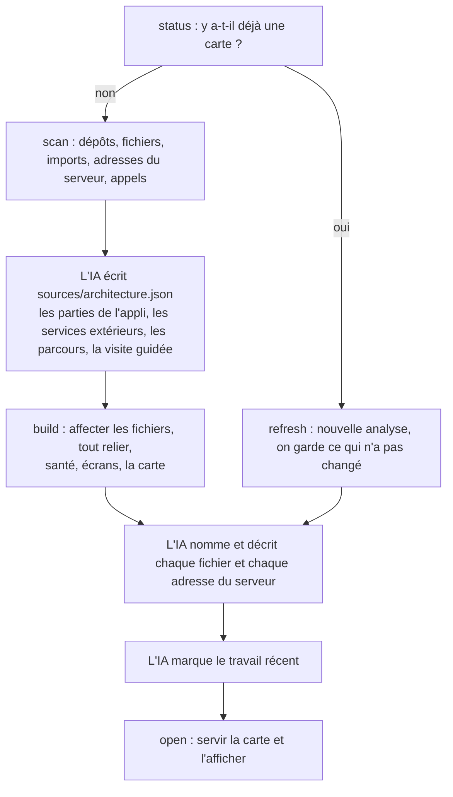

# Comment ça marche

La carte partage le travail entre des scripts et Claude Code, dans lequel tu la lances. Les scripts font tout le travail mécanique : trouver les fichiers, lire le code, relier les appels aux adresses du serveur, disposer la carte. Ce sont des scripts Node.js sans dépendance, et ils ne coûtent aucun jeton. L'IA fait ce que seul un lecteur du code peut faire : décider ce que les parties de ton appli *sont*, et les expliquer simplement.

## Ce qui consomme des jetons

| Action | Claude | Jetons |
|---|---|---|
| Analyser le code, contrôle de santé, liens coupés, bouton **Mettre à jour** | Non, ce sont des scripts sur ton ordinateur | **Aucun** |
| Ouvrir, parcourir, chercher, exporter la carte | Non | **Aucun** |
| Première carte : choisir les parties, nommer et décrire les fichiers | Oui | Sur ton compte Claude, plus c'est gros, plus ça coûte |
| Bouton **Décrire**, ou demande à Claude dans le terminal : nommer les fichiers nouveaux | Oui, seulement ceux-là, 40 au plus par clic avec le bouton | Sur ton compte Claude |
| Poser une question dans la bulle, demander un parcours | Oui, à chaque question | Sur ton compte Claude |

Un nouveau fichier apparaît donc tout de suite après **Mettre à jour**, avec un nom provisoire. Il garde ce nom tant que tu ne cliques pas sur **Décrire**, sur la fiche du projet.

Avec ce bouton, Claude ne peut toujours rien modifier : il lit les fichiers de la liste et renvoie des noms. La carte ne garde que ce qui a été demandé, refuse ce qui ressemble à une clé, puis écrit dans `la-carte/sources/descriptions/`. Le bouton utilise un modèle moins coûteux que celui de la première carte (Sonnet), sauf si tu en as choisi un autre pour la carte.

## 1. L'analyse

`analyser.mjs` trouve chaque dépôt Git sous le dossier que tu lui indiques (un dépôt, un monorepo, ou plusieurs dépôts côte à côte), en ignorant les copies de travail en double. Il liste les fichiers avec Git, donc ton `.gitignore` est respecté, puis il en extrait :

- les **imports**, résolus vers de vrais fichiers : alias de chemins TypeScript, paquets Python, modules Go, crates Rust, paquets de la JVM ;
- les **définitions exportées** et leurs commentaires de documentation ;
- les **adresses du serveur** que le serveur définit ;
- les **appels au serveur** que le code fait ;
- des **empreintes** du contenu, pour que les mises à jour suivantes sachent ce qui a changé.

Langages pris en charge : TypeScript et JavaScript (y compris les fichiers Vue, Svelte et Astro), Python, Go, Rust, Java, Kotlin, Scala et Groovy, avec une prise en charge plus légère des autres.

## 2. Relier les appels aux adresses du serveur

Les lignes les plus utiles de la carte relient les appels au serveur d'un écran au code du serveur qui y répond, souvent entre dépôts. La carte :

- **Trouve les adresses du serveur** dans Express, Fastify (préfixes de plugins compris), Koa, Hono, Next.js (fichiers de routes et routes d'API), Firebase Cloud Functions, Flask, FastAPI, Django, Go (net/http, Gin, Echo, chi, Fiber), Actix, Axum et Spring, et dans les tables de routes indexées par méthode et chemin (`"GET /api/orders": listOrders`) en JavaScript et en Python.
- **Résout les préfixes** : les blueprints Flask enregistrés avec un `url_prefix`, et les routeurs Express montés avec `app.use('/api/users', usersRouter)`, y compris les routeurs montés dans d'autres routeurs et les montages précédés d'un intergiciel.
- **Trouve les appels** faits avec `fetch`, axios, ky, `requests` et similaires, y compris :
  - les adresses construites d'abord dans une variable : `const url = …; api.get(url)` ;
  - les gabarits de texte avec des parties imbriquées ;
  - les petites fonctions d'aide du même fichier qui ajoutent un préfixe, comme `call('/definitions')`.
- **Gère les Firebase Cloud Functions**, qui s'appellent par leur nom et non par une adresse. Une fonction appelable (`onCall`) apparaît comme `CALL /approveItem`, sous le nom que le fichier d'entrée de tes fonctions lui donne en l'exportant, et les `httpsCallable(functions, 'approveItem')` du site l'atteignent, même à travers une fonction d'aide à toi qui enveloppe `httpsCallable`. Une fonction `onRequest` est une adresse du serveur ordinaire à `/<nom>`, et une appli Express qu'on lui passe garde ses propres routes sous ce nom. Les fonctions planifiées et les autres tâches de fond (Firestore, Storage, Pub/Sub) sont listées pour que l'IA les place sur la carte.
- **Associe** les deux. Quand un appel n'écrit qu'une partie de l'adresse, parce que l'adresse de base est dans les réglages, la carte apprend le chemin de base de chaque client et préfère les associations qui y correspondent.

C'est de la reconnaissance de motifs, pas un compilateur : elle trouve la plupart des liens, pas tous. Si un lien important manque, demande qu'on l'ajoute à la carte, et il sera enregistré comme un lien explicite.

## 3. L'IA décrit le système

Claude lit le résumé de l'analyse, les README, les fichiers de réglages et les points d'entrée, puis écrit `sources/architecture.json` :

- les grandes parties de ton appli, chacune avec un résumé en langage simple ;
- les services extérieurs avec lesquels elle parle vraiment (bases de données, paiement, e-mail) ;
- les liens que l'analyse ne voit pas, comme les files d'attente, les tâches planifiées et les webhooks ;
- quelques parcours guidés et une visite « Commencer ici ».

La construction affecte ensuite chaque fichier à la partie la plus profonde dont les motifs correspondent, et signale ce qui reste.

Puis `decrire.mjs` écrit une feuille de travail pour chaque partie. C'est un condensé de chaque fichier et adresse du serveur : ce qu'il définit, ses commentaires de documentation, ce qu'il utilise et ce qui l'utilise. L'IA remplit un nom et une description pour chacun. Sur les gros projets, Claude Code répartit les feuilles entre plusieurs aides en parallèle.

Par défaut, tout est écrit pour la personne qui possède l'appli, pas pour un ingénieur : ce que fait chaque chose pour l'activité, avec des mots de tous les jours. Demande une carte pour développeurs et le style devient technique.

## 4. La construction

`construire.mjs` vérifie tout ce que l'IA a écrit et signale les problèmes par leur nom (« voulais-tu dire … »). Puis il :

- relie les parties, grâce aux imports, aux appels associés et aux liens explicites de l'IA ;
- lance le **contrôle de santé** ;
- détecte les **écrans** : Next.js, React Router, Vue, SvelteKit, Remix, Nuxt, Astro, Expo, Angular, TanStack ;
- écrit `.cache/graphe.json` et le fichier autonome `index.html`.

La carte se dispose toute seule dans ton navigateur avec [ELK](https://eclipse.dev/elk/), donc la construction elle-même est rapide.

## 5. Le travail récent

Après chaque création ou mise à jour, l'IA note ce sur quoi elle vient de travailler dans `.cache/travail-recent.json`. `recents.mjs` liste les faits : ce qui a changé depuis la dernière carte, les modifications pas encore enregistrées, et les commits récents, chacun rattaché à son bloc. L'IA ajoute le *pourquoi* : ce que tu avais demandé, et en quoi chaque changement y répond. Les mises en avant précédentes sont remplacées à chaque fois.

## 6. L'afficher

`ouvrir.mjs` démarre en arrière-plan le petit serveur local de la carte et ouvre ton navigateur. Si le serveur tourne déjà pour cette carte, il est réutilisé, et l'onglet ouvert se recharge sur place au lieu d'en ouvrir un nouveau.

## Les mises à jour

`actualiser.mjs` refait l'analyse et la compare à la dernière construction, avec l'empreinte de chaque fichier :

- **contenu exact**, qui repère les modifications, les renommages et les déplacements ;
- **signature** : ses exports, ses adresses du serveur et ses commentaires de documentation. Les modifications à l'intérieur du corps d'une fonction ne comptent pas.

Il :
- reporte les descriptions sur les fichiers et adresses du serveur déplacés ou renommés ;
- garde les descriptions d'un fichier absent : il peut revenir, par exemple quand tu changes de branche ;
- supprime les entrées des fichiers effacés ;
- signale à relire les entrées dont la signature a changé.

Puis il reconstruit. L'IA n'a plus qu'à décrire ce qui est nouveau ou signalé, et à vérifier la structure si le changement était grand. C'est pour ça que les mises à jour sont rapides.

## Les plans

Tout ce qui précède décrit comment la carte cartographie du code existant, son travail principal. Un plan est l'autre entrée : une carte de quelque chose qui n'est pas encore construit. L'IA lit un cahier des charges ou une description et écrit `la-carte/sources/plan.json` : chaque fichier et chaque adresse du serveur dont le système aurait besoin, quel écran appelle quelle adresse, quelles parties utilisent des services extérieurs et la base de données, et qui peut utiliser chaque adresse. Il liste aussi la technologie choisie, les hypothèses et les questions que le cahier des charges laisse ouvertes.

`plan.mjs` transforme le plan en la même analyse que `analyser.mjs` fait à partir du code, donc la construction, les Écrans, les parcours, la visite et les questions marchent tous de la même façon. Les différences :

- les blocs ont un contour en pointillés et le tableau porte l'étiquette **Plan** ;
- la Santé devient une **revue du plan** : adresses du serveur que tout le monde pourrait utiliser pour changer des données, adresses sans décision sur qui peut les utiliser, questions ouvertes, et éléments reliés à rien ;
- chaque partie a **Construire ça avec Claude** : une demande pour construire cette partie comme prévu, qui liste ses fichiers, ses adresses du serveur et ce dont elle dépend ;
- la bulle de questions répond à partir du plan et du cahier des charges, puisqu'il n'y a pas de code à lire ;
- l'interrupteur **Modifier** de la bulle de questions prend des demandes comme « prévois aussi les remboursements » : Claude renvoie le plan mis à jour, le serveur de la carte le vérifie avec `plan.mjs` et `construire.mjs` (en renvoyant une fois les problèmes), l'enregistre et redessine la carte en mettant les changements en avant, et **Annuler** remet le plan précédent. Le bouton **Résoudre sur la carte** de chaque point de la revue du plan remplit cette demande à ta place : une question ouverte n'attend que ta réponse. L'agent reste en lecture seule : seul le serveur écrit, et seulement `sources/plan.json`, `sources/architecture.json` et `.cache/travail-recent.json`.

Mettre à jour un plan le redessine à partir de `sources/plan.json`. Quand le code existe, `actualiser.mjs --from-code` cartographie le vrai code à la place, et `sources/plan.json` reste.

## Poser des questions

Le serveur de la carte répond à chaque question avec Claude Code, qui est sur ton ordinateur, dans ton projet : il lance `claude -p` avec seulement des outils en lecture, c'est-à-dire lire et chercher dans les fichiers, et `la-carte/.cache/requete.mjs`, qui fait des recherches dans la carte. Il lui interdit d'ouvrir les fichiers de secrets (`.env`, `.env.*`, `*.pem`, `*.key`, et tout nom qui contient `secret`, `token` ou `credential`), et ne charge pas les serveurs MCP de ta machine. Une question de suite reprend la même session. Claude répond par du texte plus les blocs à montrer, donc les réponses peuvent citer du vrai code.

Dans l'application Claude, la carte interroge Claude par l'application, avec les mêmes recherches mais sans accès à ton code source.

Ces mêmes recherches (`node la-carte/.cache/requete.mjs` avec `find`, `show`, `path` ou `overview`) peuvent servir à une session ordinaire de Claude Code : cette copie n'écrit rien dans tes fichiers de notes pour le lui dire, mais tu peux lui demander de consulter la carte avant de chercher dans le code.
