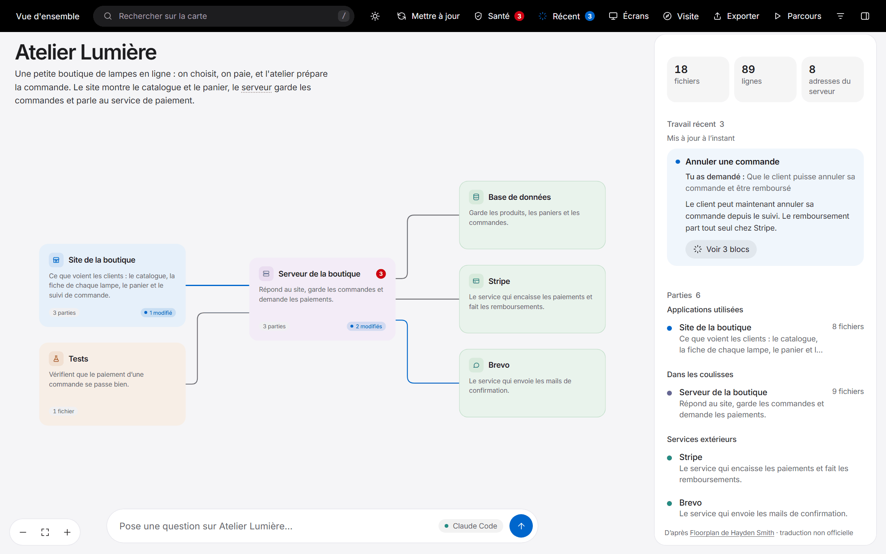
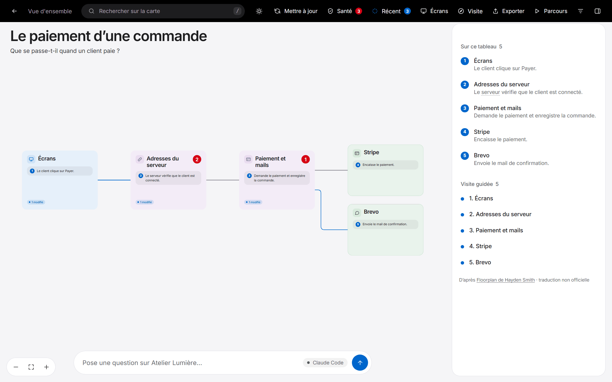
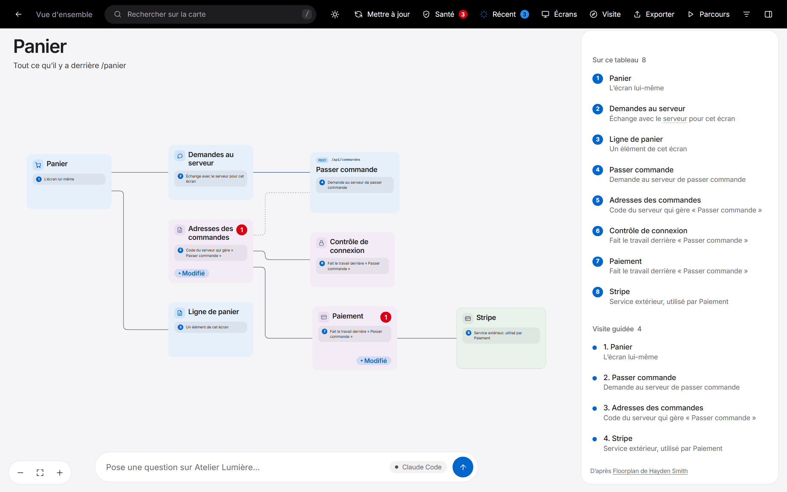
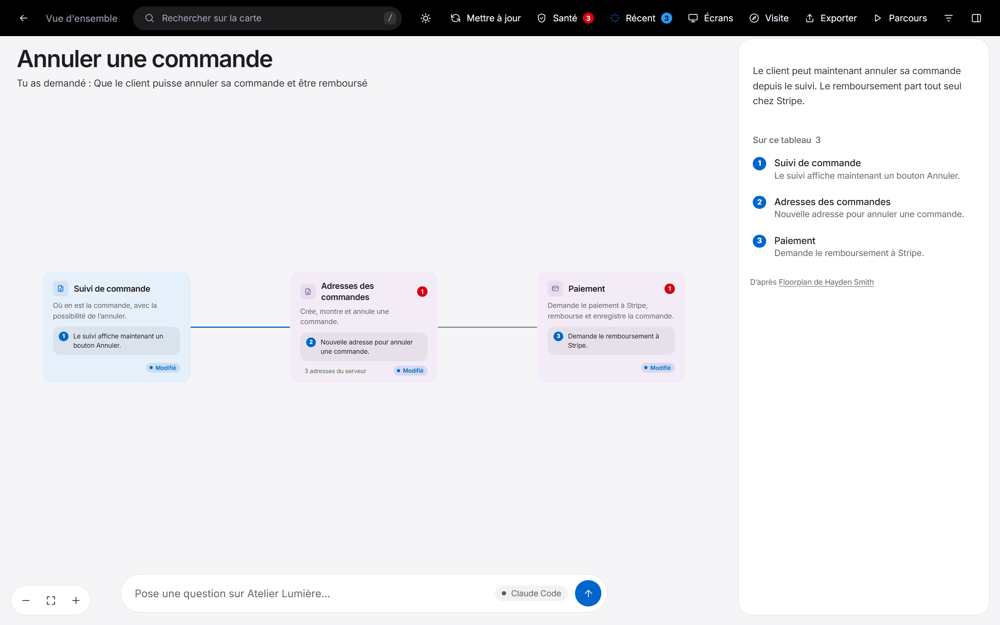
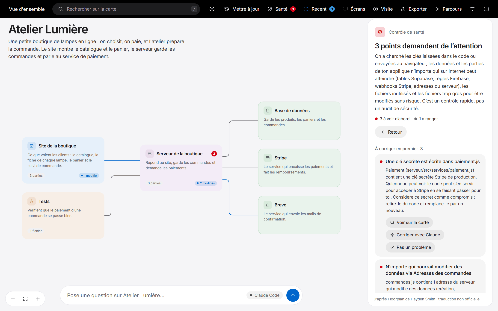
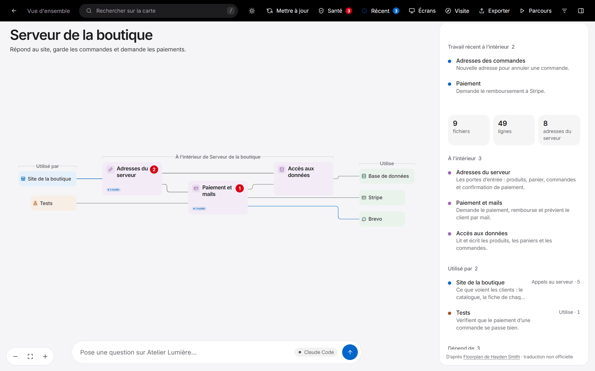
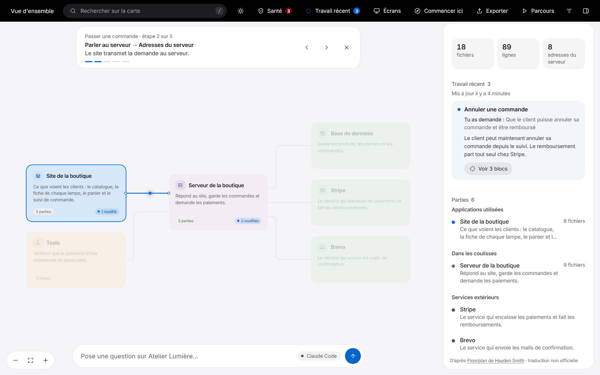
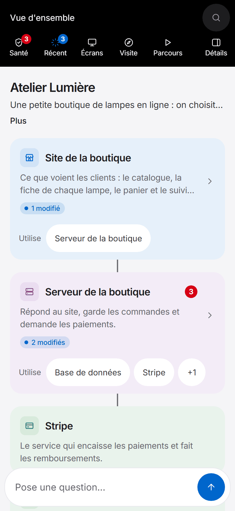
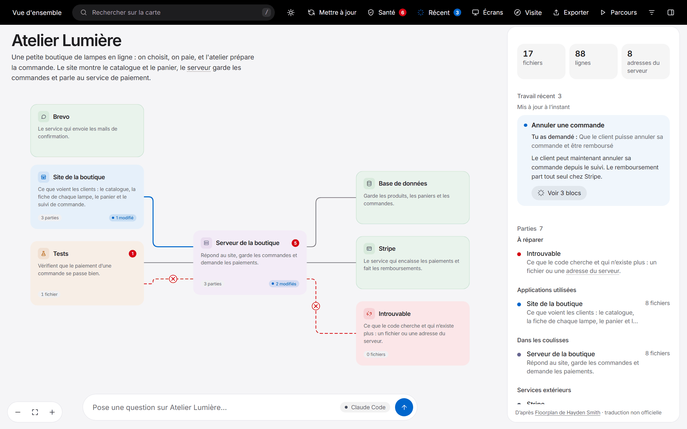

# Tout ce que fait la carte

> Traduction française non officielle de Floorplan, de Hayden Smith. Voir le [README](../README.md).

## Fonctions

<table>
<tr>
<td width="50%" valign="top">

**🗺️ Une carte à chaque niveau de zoom** 
Pars de l'appli entière, puis double-clique pour entrer dans une partie, un groupe de fichiers, un fichier, et ses adresses du serveur. Chaque vue montre ce qui l'utilise et ce qu'elle utilise.

</td>
<td width="50%" valign="top">

**💬 Du langage simple partout** 
« Encaisse les paiements par carte à la commande », pas « enveloppe de l'API Stripe ». Les termes techniques s'expliquent au survol, et un interrupteur affiche la vue pour développeurs.

</td>
</tr>
<tr>
<td valign="top">

**🔌 De vrais liens, même entre dépôts** 
Elle suit les imports, et relie chaque appel au serveur de ton interface à l'adresse du serveur qui y répond, même quand ils sont dans des dépôts séparés.

</td>
<td valign="top">

**🖥️ Partir d'un écran** 
Choisis une page que tu connais et vois tout ce qu'il y a derrière : ses parties, les appels qu'elle fait, le code du serveur, les données et les services extérieurs.

</td>
</tr>
<tr>
<td valign="top">

**🧭 Poser une question à la carte** 
« Comment un remboursement arrive-t-il sur la carte bancaire du client ? » donne une réponse et une mini-carte des seuls éléments concernés, avec une explication pas à pas.

</td>
<td valign="top">

**🩺 Contrôle de santé** 
Repère les erreurs classiques des applis faites avec l'IA : clés dans le code ou envoyées au navigateur, tables Supabase lisibles par tout le monde, règles Firebase ouvertes, webhooks Stripe que n'importe qui pourrait falsifier, adresses du serveur sans connexion. Chaque problème vient avec une demande de correction prête à coller. Un contrôle, pas un audit, et il se trompe parfois.

</td>
</tr>
<tr>
<td valign="top">

**🟢 Travail récent** 
Les blocs que ton IA vient de changer s'allument en vert, chacun avec une note qui dit en quoi la modification répond à ce que tu avais demandé.

</td>
<td valign="top">

**⚡ À jour, et à toi** 
Une mise à jour ne relit que ce qui a changé, et une carte déjà ouverte se recharge toute seule. Tout tourne sur ta machine, et rien n'est enregistré dans Git.

</td>
</tr>
</table>

Il y a aussi des **parcours** guidés que tu peux demander avec tes mots, une **visite guidée** d'une minute (**Commencer ici**), **Exporter** pour envoyer une copie à n'importe qui en un seul fichier HTML, une disposition pour **téléphones et tablettes** avec glisser et pincer, la recherche, des raccourcis clavier et des actions au clic droit sur chaque bloc.

### Les plans, pour une appli pas encore construite

La carte est faite pour cartographier du code que tu as déjà. Elle peut aussi partir d'un cahier des charges, d'une spécification ou d'une description de ce que tu veux construire, et dessiner un **plan** : la même carte, qui montre chaque partie, fichier, adresse du serveur et écran dont tu aurais besoin et comment ils s'assembleraient. Les blocs sont en pointillés pour montrer que c'est un plan. À la place du contrôle de santé, tu as une revue de ce que le plan laisse encore ouvert, chaque partie a sa demande toute prête pour la construire, et tu peux remodeler le plan depuis la carte (« prévois aussi les remboursements »). Quand le code existe, le plan devient une carte de la vraie appli. Voir [Planifier une appli pas encore construite](bien-demarrer.md#planifier-une-appli-pas-encore-construite).

## Voir en images

Ces captures montrent une boutique fictive, Atelier Lumière.

<table>
<tr>
<td width="50%" valign="top">

<b>Poser une question à la carte.</b> La réponse s'écrit en français et se dessine sur un tableau, avec seulement les blocs concernés.

</td>
<td width="50%" valign="top">

<b>Partir d'un écran.</b> Choisis une page et vois tout ce qu'il y a derrière, du bouton jusqu'à la base de données et aux services extérieurs.

</td>
</tr>
<tr>
<td valign="top">

<b>Travail récent.</b> Ce que tu avais demandé, ce qui a changé et pourquoi chaque changement était nécessaire, sur un seul tableau.

</td>
<td valign="top">

<b>Contrôle de santé.</b> Une clé oubliée dans le code et une adresse du serveur que tout le monde peut utiliser, chacune avec une demande de correction en un clic.

</td>
</tr>
<tr>
<td valign="top">

<b>Entrer dans une partie.</b> Ce qu'elle contient, ce qui l'utilise et ce dont elle dépend. Les petites étiquettes marquent ce qui vient de changer.

</td>
<td valign="top">

<b>Parcours guidés.</b> Regarde un appel traverser l'appli étape par étape, ou demande qu'on en suive un nouveau.

</td>
</tr>
<tr>
<td valign="top">

<b>Sur téléphone.</b> Une colonne qui défile, sans zoom ni déplacement.

</td>
<td valign="top">

<b>L'état du code à l'instant T.</b> Les liens coupés se voient en rouge, les blocs concernés portent une pastille. <b>Mettre à jour</b> refait la carte en quelques secondes, sans consommer de jetons. <b>Décrire</b> demande ensuite à Claude de nommer les nouveaux fichiers, seulement quand tu le veux.

</td>
</tr>
</table>

## Ce que la carte sait lire

**Langages :** TypeScript, JavaScript, Python, Go, Rust, Java, Kotlin, Scala, plus les fichiers Vue, Svelte et Astro, avec une prise en charge plus légère des autres. 
**Adresses du serveur :** Express, Fastify, Koa, Hono, Next.js, Firebase Cloud Functions, Flask, FastAPI, Django, net/http de Go, Gin, Echo et chi, Actix, Axum, Spring, et les tables de routes indexées par méthode et chemin (`"GET /api/orders": listOrders`) en JavaScript et en Python. 
**Écrans :** Next.js, React Router, Vue, SvelteKit, Remix, Nuxt, Astro, Expo, Angular, TanStack.
