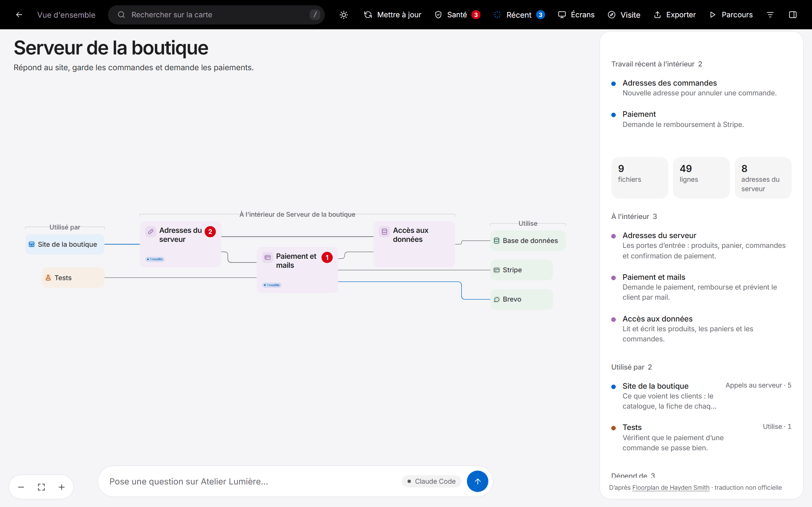
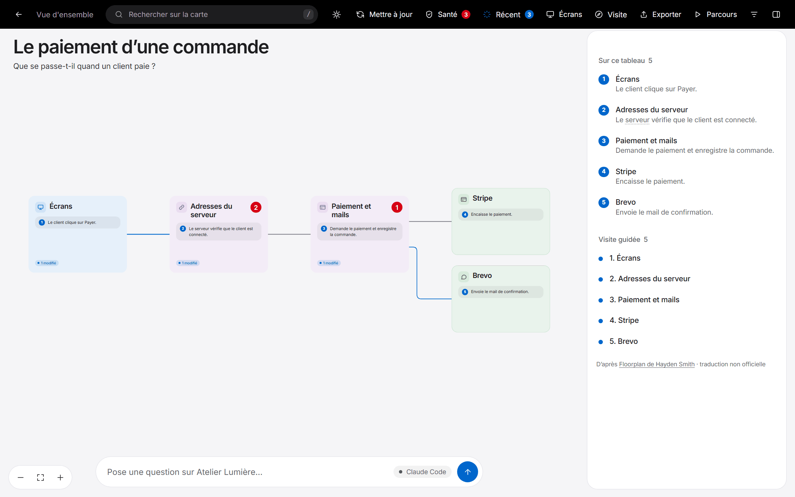

# Utiliser la carte

La carte est un tableau de blocs reliés par des lignes. Chaque bloc est une partie de ton appli : une grande zone comme « Serveur principal », un groupe de fichiers, un seul fichier, ou une adresse du serveur (un appel que le serveur peut recevoir). Les lignes montrent qui utilise quoi.

> Les captures d'écran de ce guide viennent de la version d'origine de Floorplan : leur interface est en anglais.

## Se déplacer

| Pour… | Fais ceci |
|---|---|
| entrer dans un bloc | double-clique dessus, ou sélectionne-le et appuie sur **Entrée** |
| remonter | **Retour arrière**, la flèche de retour, ou le fil d'Ariane en haut |
| déplacer la vue | fais glisser le fond |
| zoomer | molette, ou **+** / **−** |
| tout faire tenir à l'écran | **F**, ou le bouton de cadrage en bas à gauche |
| tout chercher | **/** ou **Ctrl/⌘ K**, puis tape un nom, un fichier ou une adresse |
| voir les détails | clique sur un bloc ; le panneau de droite se remplit |
| afficher ou masquer le panneau | **P**, ou le bouton du panneau en haut à droite |
| fermer un menu, arrêter un parcours, effacer une sélection | **Échap** |

Les détails des blocs se simplifient quand tu dézoomes : les descriptions disparaissent et les titres grossissent, pour que la carte reste lisible de loin.

### Sur un téléphone ou une tablette

- **Sur un téléphone**, pas de zoom ni de déplacement : les blocs se suivent dans une colonne qui défile. Touche un bloc pour l'ouvrir, ou pour voir ses détails dans une feuille en bas s'il n'a pas d'intérieur. Sous chaque bloc, **Utilise** liste ce à quoi il est relié : deux liens d'abord, et **+N** montre les autres.
- **Sur une tablette**, le schéma reste : **fais glisser** avec un doigt pour déplacer la vue, et **pince** avec deux doigts pour zoomer. Le panneau démarre fermé pour laisser la place à la carte, et s'ouvre quand tu touches un bloc.
- La barre du haut passe sur deux lignes et ses boutons n'affichent que leur icône, avec un mot dessous sur un téléphone. Sur un téléphone, la description sous le titre se replie sur une ligne, avec **Plus** pour lire la suite.

Rien ne change à la souris dans une fenêtre de 1000 px de large ou plus. Le support des téléphones et des tablettes a été construit par [@menachem-kurkus](https://github.com/menachem-kurkus).

## Les blocs

- **Titre et description :** un nom en langage simple, et une ligne sur ce qu'il fait.
- **Couleur :** une par groupe : bleu pour l'appli, violet pour les coulisses, vert pour les services extérieurs, orange pour les outils. Un bloc intérieur prend la couleur de sa partie.
- **Petite icône :** choisie selon ce que fait le bloc dans ce projet, par exemple un caddie pour un magasin.
- **Pied :** ce qu'il y a dedans (modules, fichiers ou adresses du serveur) à gauche. À droite, une étiquette verte quand il fait partie du travail récent.
- **Les blocs d'adresse du serveur** montrent la méthode et l'adresse (`POST /api/orders`) au-dessus de leur nom.
- **Un petit point ambre** après un titre veut dire qu'une note est épinglée sur ce fichier.
- **Les petits blocs sur les bords** d'une vue sont des éléments extérieurs à elle. Les crochets au-dessus de chaque colonne disent de quel côté on est :
  - **Utilisé par :** les parties extérieures qui utilisent celle-ci ou l'appellent.
  - **Dans ‹nom› :** de quoi cette partie est faite.
  - **Utilise :** les parties extérieures dont elle dépend, comme une base de données ou Stripe.

  Double-clique sur un bloc extérieur pour y aller.

Laisse la souris un instant sur un bloc pour voir de quel genre de chose il s'agit, où il se trouve et sa taille. Laisse-la sur une ligne pour voir ce qu'elle transporte, par exemple quelles adresses du serveur un écran appelle.

## Le panneau latéral

Clique sur n'importe quoi pour le voir dans le panneau : sa description complète, de quoi il fait partie, ce qu'il contient, par quoi il est **utilisé** et de quoi il **dépend**, ses adresses du serveur, et des boutons pour l'ouvrir ou poser une question dessus. Sans sélection, le panneau décrit la vue actuelle, ou toute l'appli au niveau le plus haut.

Fais glisser le bord gauche du panneau pour le redimensionner.

## Les boutons du haut

### Santé
Un compte des problèmes importants, et une liste en langage simple de ce que l'analyse a trouvé :
- mots de passe et clés écrits dans le code, ou dans un fichier `.env` enregistré dans Git ;
- clés secrètes dans des réglages que le navigateur reçoit, comme une clé OpenAI dans une variable `VITE_` ou `NEXT_PUBLIC_` ;
- tables Supabase dont la sécurité au niveau des lignes est désactivée, et règles de base de données qui laissent n'importe qui modifier une table ;
- règles Firebase qui laissent n'importe qui lire ou changer tes données ou tes fichiers, y compris les règles du « mode test » et la date où elles expirent ;
- webhooks Stripe qui agissent sur des paiements sans vérifier la signature de Stripe, donc que n'importe qui pourrait falsifier ;
- serveurs que n'importe quel site web peut appeler, signalés comme à corriger quand les cookies de connexion suivent ;
- adresses du serveur qui laissent n'importe qui changer ou lire des données sans se connecter ;
- fichiers inutilisés ;
- fichiers de plus de 1 000 lignes environ, que l'IA a du mal à modifier sans risque.

Chaque problème a **Voir sur la carte**, qui met en avant les fichiers et adresses du serveur concernés avec des notes, et **Corriger avec Claude** (ou **Corriger avec Codex**, pour une carte faite dans Codex), qui copie une demande toute prête nommant les fichiers et lignes exacts et la correction sûre. C'est un contrôle automatique rapide, pas un audit de sécurité : **il donne des fausses alertes, et il laisse passer des choses.** Sur un plan, ce bouton devient **Revue du plan** (voir [Les plans](#les-plans)).

La Santé laisse tranquilles les empreintes de mots de passe et les valeurs chiffrées (bcrypt, argon2, dotenvx, sops, Ansible Vault et similaires), et elle juge d'après la valeur, donc une sauvegarde dont une seule valeur n'est pas chiffrée est quand même signalée. Elle ne reconnaît que le chiffrement qui se signale lui-même, et elle ne peut pas lire un fichier `.env` que Git ignore. Elle ne juge pas non plus la connexion sur les adresses du serveur d'une table de routes (`"GET /api/orders": listOrders`) ni sur celles de Django, parce que le contrôle n'est pas à un endroit où elle peut le lire pour chaque route : ne rien voir là ne veut donc pas dire que ces adresses sont protégées.

Elle laisse aussi de côté ce qui est public exprès, tant que ça ne fait que lire : les flux et fichiers pour les robots et les outils d'IA (`rss.xml`, `llms.txt` et similaires), les adresses que ton projet liste dans son `llms.txt` ou autorise dans son `robots.txt`, les réponses marquées `Cache-Control: public`, et les routes `GET` de Next.js qui ne lisent ni base de données, ni session, ni secret du serveur, même à travers ce qu'elles importent. Les adresses qui changent des données sont toujours contrôlées. Les routes d'API propres à Payload CMS comptent comme contrôlées, parce que Payload applique ses règles d'accès : vérifie toi-même ces règles. Un jeton passé au script d'un outil de suivi du navigateur est aussi laissé de côté, puisque chaque visiteur l'a déjà.

Si un problème est faux, appuie sur **Pas un problème** et ajoute une raison si tu veux. Il descend en bas de la liste et sort du compte, et il reste ainsi quand la carte est reconstruite. Modifier autre chose dans le fichier ne le fait pas revenir, mais il réapparaît si le même contrôle trouve quelque chose de nouveau dans ce fichier ou si le problème change de gravité. **Afficher à nouveau** annule. Les copies exportées gardent le problème à part mais laissent ta raison de côté.

Ce choix reste sur ta machine, dans `la-carte/`. **Rien n'est envoyé à l'auteur de Floorplan ni à personne** : cette version n'a pas de signalement de fausse alerte.

### Travail récent
Apparaît quand Claude ou Codex vient de changer des choses. Il place les blocs modifiés sur un seul tableau, avec ce que tu avais demandé, un résumé de ce qui a été fait, et une note sur chaque bloc. Ailleurs sur la carte, les blocs modifiés ont un anneau vert et une étiquette **Modifié** ou **Nouveau**, et les parties qui les contiennent affichent **N modifiés**, pour que tu puisses suivre le vert depuis le niveau le plus haut.

### Écrans
Chaque page de ton appli que la carte a détectée. Choisis-en une pour voir tout ce qu'il y a derrière : ses composants, les appels qu'elle fait, le code du serveur qui y répond, les données qu'ils touchent, et les services extérieurs.

### Exporter
Enregistre une copie de la carte à envoyer à n'importe qui, comme un collègue, un client, ou une personne qui n'a ni Claude ni Codex. C'est un seul fichier HTML qui s'ouvre dans n'importe quel navigateur sans rien installer. La copie contient toute la carte, la recherche, les écrans, la visite guidée et les parcours, mais pas de bulle de questions, pas de demandes **Corriger avec Claude** ou **Construire ça**, pas de liens vers l'éditeur, et rien sur ton ordinateur, comme le chemin de ton dossier. Une étiquette **Exporté** à côté du titre montre la date.

Tu choisis ce qu'on y met :
- **Parcours et visite guidée**, et **notes épinglées sur les fichiers**, cochés par défaut ;
- **Travail récent**, décoché par défaut ;
- **Contrôle de santé** (ou la **revue du plan** sur un plan), décoché par défaut. La Santé liste les adresses du serveur que tout le monde peut utiliser et où se trouvent les secrets dans le code (jamais leurs valeurs) : ne l'inclus que pour des personnes de confiance.

Chaque copie montre comment l'appli tient ensemble (chaque partie, fichier et adresse du serveur, avec leurs noms et descriptions), mais pas ton code source. L'export a besoin du serveur de la carte ; sur une carte ouverte directement depuis son fichier, le bouton montre à la place la commande à lancer. Tu peux aussi demander à Claude ou à Codex d'« exporter la carte ».

### Commencer ici
Rejoue la visite guidée d'une minute qui se lance la première fois que tu ouvres une carte.

### Parcours
Des visites guidées des principales tâches de l'appli, comme « Commande » ou « Inscription ». Un parcours traverse le tableau étape par étape, avec un commentaire à chaque arrêt. Utilise **←** / **→** ou les boutons de la barre du parcours pour avancer, et **Échap** pour arrêter.

**Demander un nouveau parcours** te laisse en décrire un avec tes mots (« comment un remboursement revient-il sur la carte bancaire du client ? »), et Claude ou Codex le suit dans le code. Les parcours que tu demandes sont enregistrés avec la carte.

### Filtres
- **Afficher les liens :** active ou désactive des sortes de lignes (Utilise, Appels au serveur, Tâches de fond, etc.).
- **Afficher le détail technique :** passe aux termes de développeur (Imports, HTTP, Files d'attente), et montre les exports de chaque fichier.
- **Mettre en avant le travail récent :** coupe les surlignages verts pour une carte nette.

## Poser des questions

Tape dans la bulle de questions en bas et appuie sur **Entrée**. Claude ou Codex répond en quelques phrases et montre un **tableau de réponse** : seulement les blocs concernés, comment ils se relient, une courte note sur chacun, et une explication numérotée quand la réponse est une suite d'étapes. Des suggestions de suite apparaissent sous la réponse. **Retour à la carte** te ramène là où tu étais.

- **Clic droit → Poser une question à ce sujet** sur un bloc ou une ligne l'ajoute à ta question comme contexte.
- L'étiquette dans la barre montre qui répond. **Claude Code** veut dire la ligne de commande de Claude Code et **Codex** veut dire Codex, tous deux lancés sur ton ordinateur et capables de lire ton code source. **Claude** veut dire que la carte a été ouverte dans l'application Claude, qui répond à partir de la carte seule.
- Rappel honnête : ce qui répond peut lire tes fichiers pour le faire, et ce qu'il lit part chez Anthropic ou OpenAI. Avec Claude Code, les fichiers de secrets sont interdits (`.env`, `.env.*`, `*.pem`, `*.key`, et tout nom qui contient `secret`, `token` ou `credential`), mais le reste est lisible. Voir [Confidentialité et sécurité](confidentialite-et-securite.md).
- Si ni l'un ni l'autre n'est disponible, la barre explique ce qu'il faut. Voir [Dépannage](depannage.md).

## Les plans

Tout ce qui précède décrit une carte de code existant, ce que sont la plupart des cartes. Un plan est l'autre sorte : une carte prévue à partir d'un cahier des charges ou d'une spécification avant que le code existe (voir [Pour commencer](bien-demarrer.md#planifier-une-appli-pas-encore-construite)). Il marche de la même façon, avec quelques différences :

- **Des blocs en pointillés et une étiquette Plan** à côté du titre du tableau montrent que c'est un plan. Sans sélection, le panneau dit à partir de quel document il a été planifié, la technologie et les hypothèses faites.
- **Revue du plan** remplace la Santé. C'est une revue de conception du plan : adresses du serveur que tout le monde pourrait utiliser pour changer des données, adresses sans décision sur qui peut les utiliser, questions que le cahier des charges laisse ouvertes, et éléments reliés à rien. Chaque point a **Montrer sur la carte** et **Résoudre sur la carte**, qui passe la bulle de questions sur Modifier et remplit une demande pour le régler. Pour une question ouverte, tape ta réponse après « Ma réponse : » et appuie sur **Entrée**. (Quand la carte n'est pas servie, le bouton est **Résoudre avec Claude** ou **Résoudre avec Codex**, une demande à coller.)
- **Qui peut l'utiliser :** le panneau d'une adresse du serveur dit si n'importe qui, les personnes connectées (et lesquelles), ton équipe, ou un autre service peut l'utiliser.
- **La construire :** chaque partie et chaque fichier a **Construire ça avec Claude** (ou Codex), qui montre une demande pour construire cet élément comme le plan le décrit (ses fichiers, ses adresses du serveur, ce dont il dépend et les questions ouvertes), prête à copier dans Claude Code ou Codex.
- **Demander et Modifier :** la bulle de questions a un interrupteur. **Demander** répond aux questions à partir du plan et du cahier des charges. **Modifier** prend des demandes comme « prévois aussi les remboursements » ou « retire la page d'administration ». Ça prend quelques minutes ; ensuite la carte se redessine, les blocs nouveaux et modifiés sont mis en avant comme travail récent, et un résumé propose **Montrer les N changements**, **Annuler** et des idées de changements suivants.

## Menus du clic droit

| Sur | Tu obtiens |
|---|---|
| un bloc | Ouvrir · Montrer sur la carte · Poser une question à ce sujet · Afficher les détails · Copier le nom · Copier le chemin (ou l'adresse) · Ouvrir dans l'éditeur |
| une ligne | Poser une question sur ce lien · Afficher les détails |
| le fond | Poser une question sur cette vue · Remonter d'un niveau · Retour à la vue d'ensemble · Ajuster à l'écran · Chercher |

**Ouvrir dans l'éditeur** ouvre le fichier dans VS Code (ou un autre éditeur qui gère les liens `vscode://`) à la bonne ligne.
